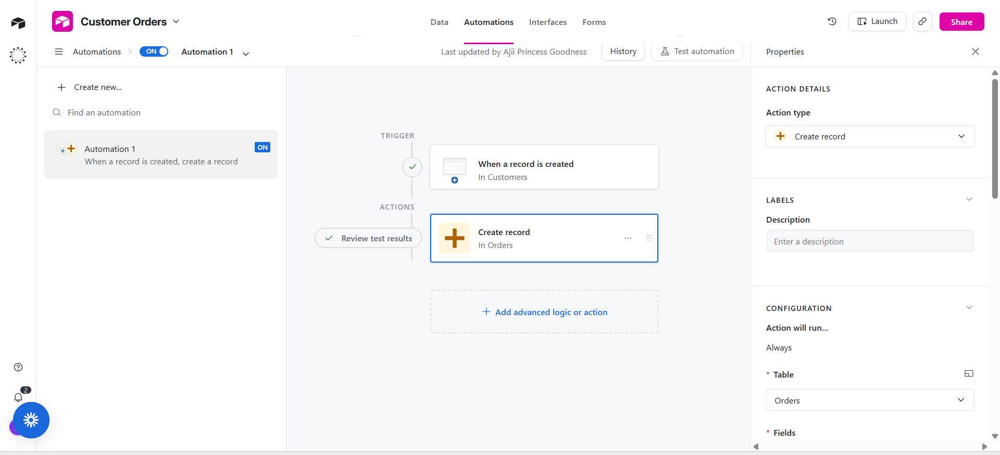
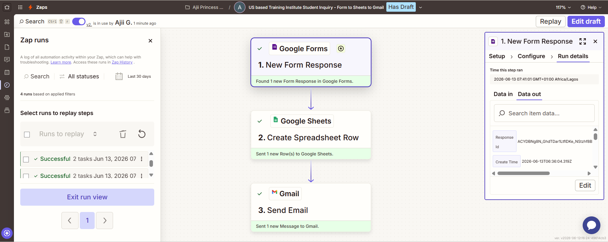
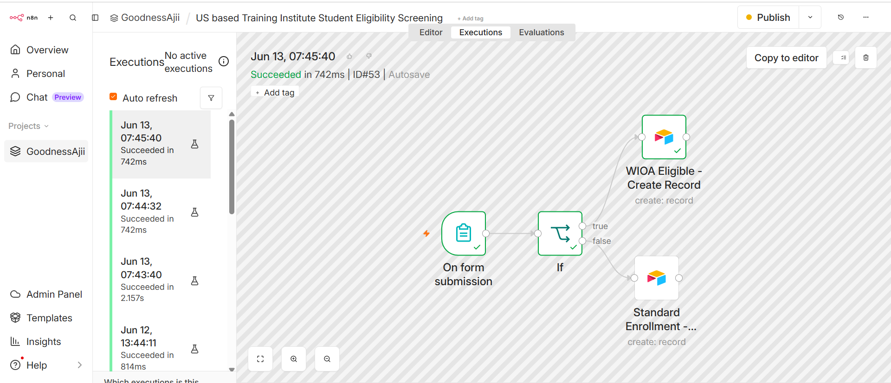
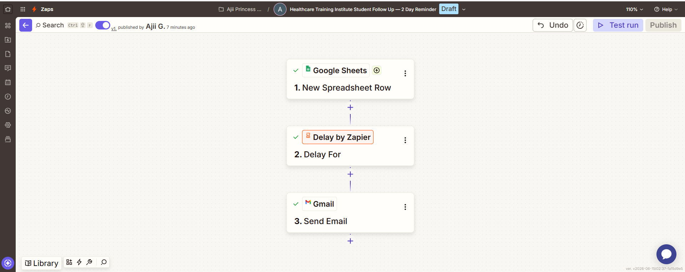
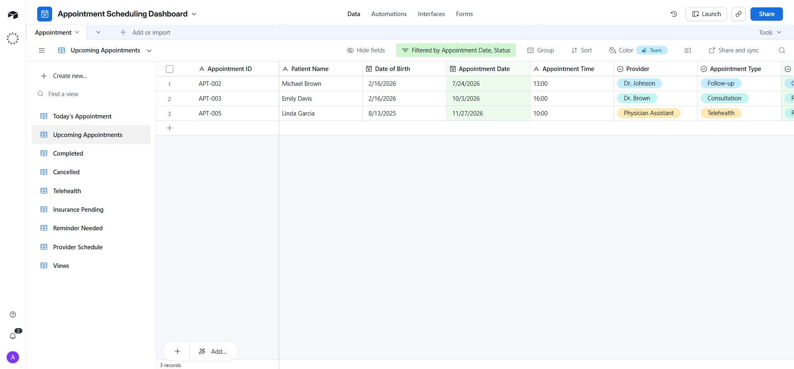
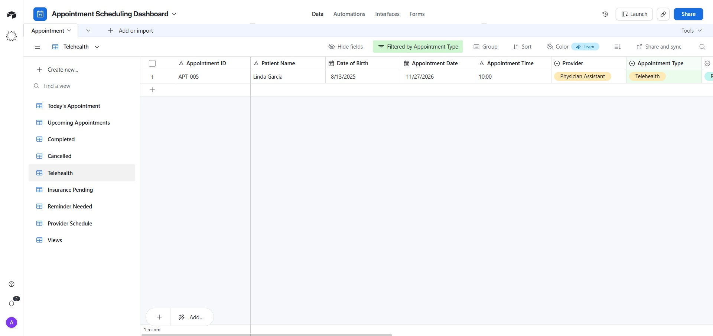
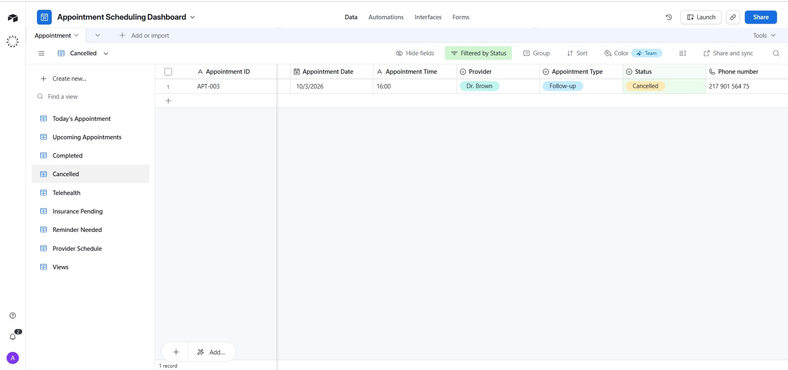
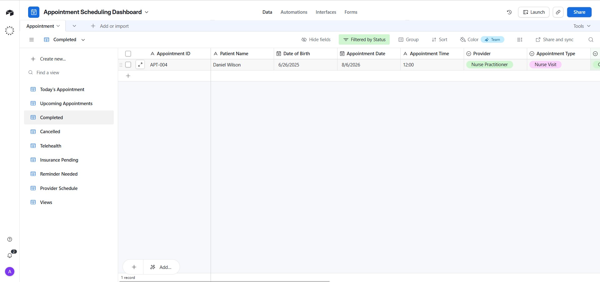
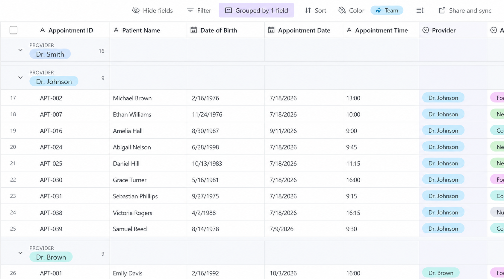
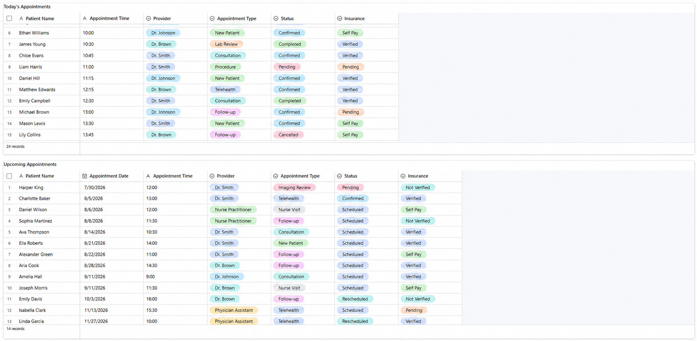

# Workflow Automation Showcase

**Goodness Ajii, RN** | Operations Automation and AI Workflow Builder

This repository documents no code workflow automations I designed, built, and tested in Zapier, n8n, and Airtable. Each project shows the operational problem, the workflow logic, the tools used, and a screenshot of the working build.

For my AI automation work and current projects, see my [GitHub profile](https://github.com/goodness-ajii).

---

## Tools Used

| Tool | What I used it for |
|---|---|
| Zapier | Form intake, spreadsheet logging, confirmation and timed follow up emails |
| n8n | Conditional routing and eligibility screening |
| Airtable | Relational databases, linked records, automations, and dashboard views |
| Google Workspace | Forms, Sheets, and Gmail as triggers and destinations |

---

## Projects

| Number | Project | Platform |
|---|---|---|
| 01 | Form to Sheets to Gmail confirmation | Zapier |
| 02 | Student registration conditional routing | n8n |
| 03 | Customer orders automation | Airtable |
| 04 | Sales tracker product database | Airtable |
| 05 | Sales tracker orders database | Airtable |
| 06 | Training institute student inquiry automation | Zapier |
| 07 | Training institute eligibility screening | n8n and Airtable |
| 08 | Two day student follow up automation | Zapier |
| 09 | Healthcare appointment management system | Airtable |

---

## 01. Form to Sheets to Gmail Confirmation

**Platform:** Zapier

**Problem:** Form submissions were logged by hand and people waited for a reply.

**Workflow:**
1. A person submits a Google Form.
2. The response is recorded in Google Sheets.
3. Gmail sends a confirmation message automatically.

**Result:** No manual data entry, and every submitter gets an immediate confirmation.

**Also applies to:** patient intake, customer onboarding, appointment requests.

---

## 02. Student Registration Conditional Routing

**Platform:** n8n

**Problem:** Registrations had to be sorted by hand into the correct program.

**Workflow:**
1. A registration form is submitted.
2. Conditional logic checks the applicant's details.
3. The applicant is routed to the correct program pathway.

**Result:** Applications are sorted automatically and consistently.

**Also applies to:** lead qualification, customer segmentation, support ticket routing.

---

## 03. Customer Orders Automation

**Platform:** Airtable Automations

**Problem:** Order records had to be created separately from customer records, causing duplicate entry.

**Workflow:**
1. A new customer record is created.
2. An Airtable automation triggers.
3. A linked order record is created automatically.

**Result:** Customer and order data stay connected without retyping.

---

## 04. Sales Tracker Product Database

**Platform:** Airtable

A relational product table holding products, pricing, and categories, linked to sales records.

**Applies to:** inventory tracking, product catalogs, order management.

---

## 05. Sales Tracker Orders Database

**Platform:** Airtable

An orders table linked to the product table, so each order pulls product and price details automatically.

---

## 06. Healthcare Training Institute Student Inquiry Automation

**Platform:** Zapier

**Problem:** Student inquiries were answered slowly and tracked inconsistently.

**Workflow:**
1. A student submits an inquiry form.
2. The details are captured and logged in a tracking spreadsheet.
3. A confirmation email is sent to the student.

**Result:** Every inquiry is logged and acknowledged the moment it arrives.

---

## 07. Healthcare Training Institute Eligibility Screening

**Platform:** n8n and Airtable

**Problem:** Applicants had to be checked by hand against program eligibility rules before staff could follow up.

**Workflow:**
1. An applicant submits their details.
2. n8n checks the details against the eligibility criteria.
3. The result is recorded in Airtable for staff to act on.

**Result:** Staff see screened applicants with a clear eligibility status instead of reviewing every application manually.

---

## 08. Two Day Healthcare Student Follow Up Automation

**Platform:** Zapier

**Problem:** Students who did not complete their application were never contacted again.

**Workflow:**
1. A new inquiry is detected.
2. The automation waits two days.
3. A follow up email is sent automatically.

**Result:** No incomplete application is forgotten.

---

## 09. Healthcare Appointment Management System

**Platform:** Airtable

**Problem:** Front desk staff had no single view of the day's appointments, pending reminders, insurance status, or cancellations.

**What I built:** A central appointment base with filtered views for each task the front desk handles.

### Provider Schedule Workflow

### Today's Appointments

### Upcoming Appointments

### Reminder Needed

### Insurance Pending

### Telehealth Appointments

### Cancelled Appointments

### Completed Appointments

### Practice Schedule

### Appointment Tables

**Next automations this system supports:** appointment reminders, confirmation tracking, insurance verification follow up, and cancellation recovery.

---

## Contact

* Email: goodnessajii@gmail.com
* LinkedIn: [linkedin.com/in/goodness-ajii](https://linkedin.com/in/goodness-ajii)
